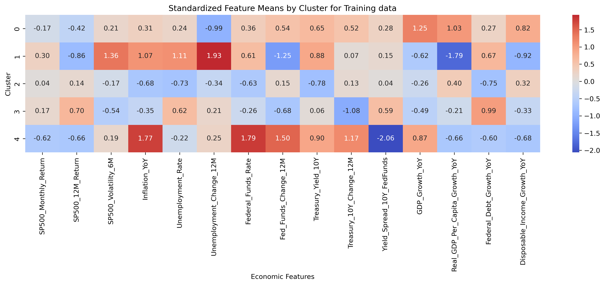
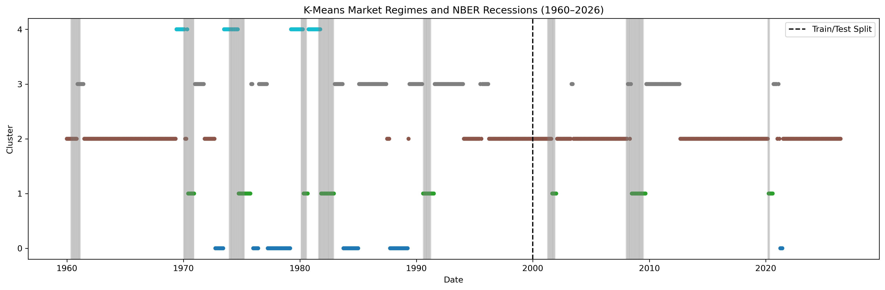
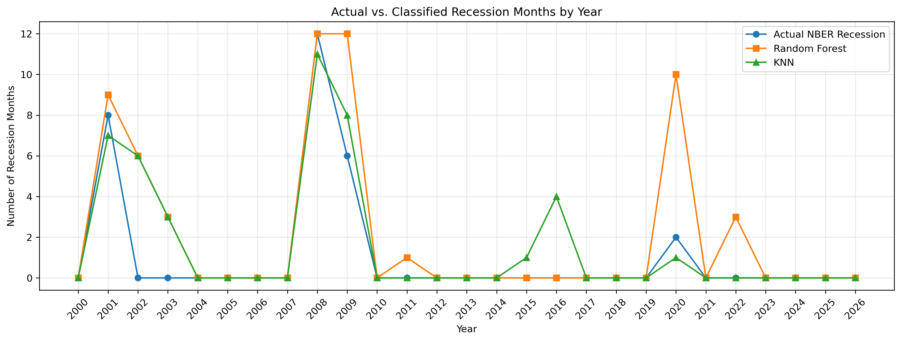
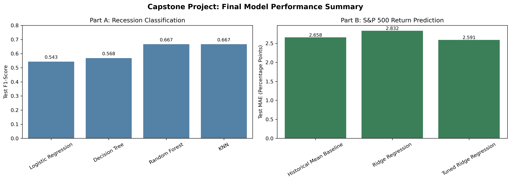

# BH-PCMLAI-Capstone-Assignment-24.1
This repository contains code for the Capstone Project 24.1 - Manali Parmar

Link to [the notebook.](https://github.com/manali-parmar/BH-PCMLAI-Capstone-Assignment-24.1/blob/main/Capstone%20Project%2024.1.ipynb)

# Identifying U.S. Economic and Financial Market Regimes Using Machine Learning

## Project Overview

This capstone project uses machine learning to study historical U.S. economic and financial conditions from **1960 to June 2026**. The project has two parts:

- **Part A:** Identify economic regimes and classify historical recession months.
- **Part B:** Examine whether economic and financial indicators can predict the following month's S&P 500 return.

The goal is to understand historical patterns and evaluate model performance, not to predict recessions in advance.

## Data and Approach

Monthly economic and financial data was collected from **Federal Reserve Economic Data (FRED)** and **Multpl**. The analysis includes stock market performance, GDP, inflation, unemployment, interest rates, and other U.S. economic indicators. Official NBER recession indicators were used to evaluate recession classifications.

For Part A, **15 engineered features** were used. The data was divided chronologically into a **training period (1960-1999)** and a **testing period (2000-June 2026)**. Principal Component Analysis (PCA) reduced the standardized features to six components, retaining **86.1%** of the variation in the training data.

## Part A: Economic Regimes and Recession Classification

### Identifying Economic Regimes

Three unsupervised learning methods were compared: **K-Means, Gaussian Mixture Models (GMM), and DBSCAN**.

**K-Means** produced five clusters with the clearest economic interpretation, including periods associated with market stress, growth, recovery, and inflation or monetary tightening. GMM identified eight overlapping groups, while DBSCAN highlighted unusual observations.

The following charts show the main characteristics of the K-Means clusters and how the assigned regimes changed over time.
    
    - Cluster 0: Moderate Growth
    - Cluster 1: Market Stress
    - Cluster 2: Stable Growth
    - Cluster 3: Market Recovery
    - Cluster 4: High Inflation / Monetary Tightening

The FRED USREC indicator was used to identify official NBER recession months, providing a reliable reference for evaluating the recession classification models.

### Classifying Recession Months

Four classification models were evaluated: **Logistic Regression, Decision Tree, Random Forest, and K-Nearest Neighbors (KNN)**. Models were tuned using chronological cross-validation.

**Random Forest and KNN both achieved a test F1 score of 0.667**, but their results differed:

- **Random Forest** identified all 28 recession months, but incorrectly classified 28 non-recession months as recessions.
- **KNN** identified 23 of the 28 recession months, missing five, but produced fewer false recession classifications (18).

The chart below compares the number of actual and classified recession months by year. These are historical, same month classifications not forecasts made ahead of recessions.

## Part B: S&P 500 Return Prediction

Part B used **17 economic and financial features** to predict the following month's S&P 500 return. Ridge Regression was compared with a simple baseline.

The tuned Ridge model achieved a **Mean Absolute Error (MAE) of 2.591 percentage points**, compared with **2.658** for the baseline. However, its **R² was only 0.005**, meaning it explained approximately **0.5% of the variation** in monthly returns. The small improvement in MAE and low R² show the difficulty of predicting short-term market returns using these indicators.

## Key Findings and Limitations

The FRED USREC indicator provided official NBER recession dates, allowing the classification models to be evaluated against actual historical recessions. This helped identify correctly classified recession months, missed recessions, and false positives. K-Means provided useful historical groupings but predicting next-month S&P 500 returns remained challenging. 
